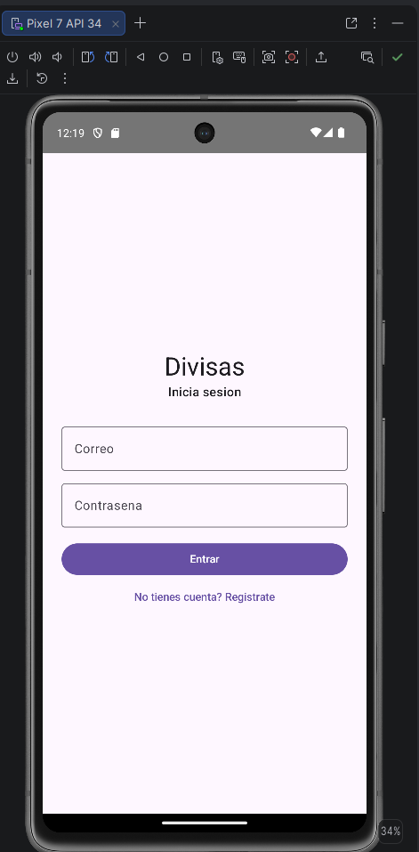
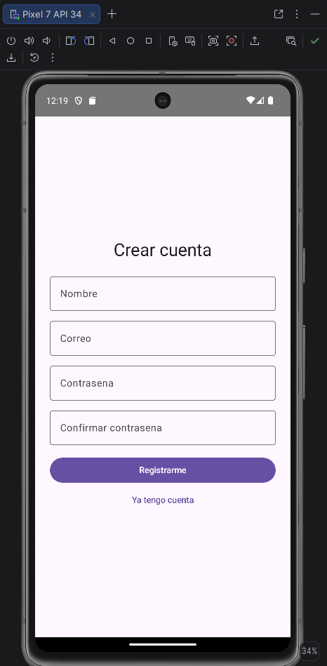
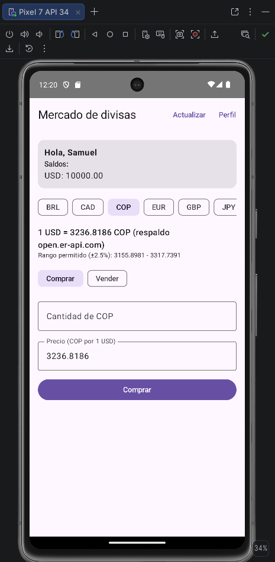
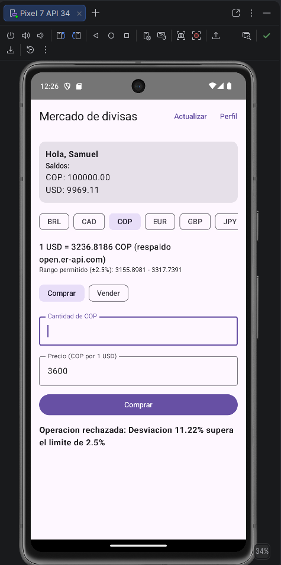
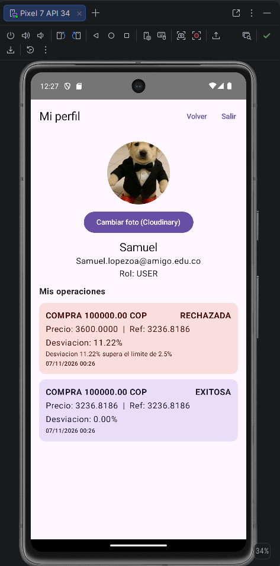
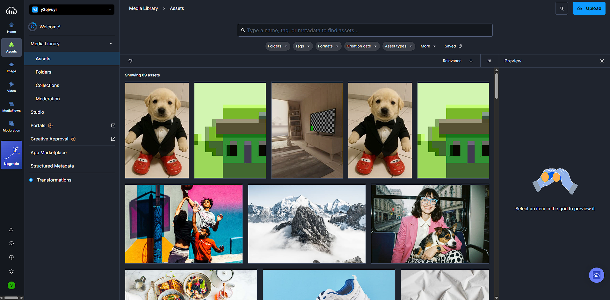

# Divisas App

Aplicacion Android de compra y venta de divisas. **Kotlin + Jetpack Compose**, arquitectura **MVVM**, sin Java y sin XML de layouts.

## Servicios externos
- **Firebase Authentication**: registro e inicio de sesion.
- **Cloud Firestore**: persistencia de usuarios, saldos y operaciones.
- **Cloudinary**: almacenamiento de la foto de perfil.
- **Finnhub**: tasas de cambio (`/forex/rates`).

## Arquitectura
```
data/model        -> UserProfile, FxTransaction
data/remote       -> FinnhubApi, CloudinaryApi (Retrofit)
data/repository   -> Auth, Rate, Media, Transaction
ui/<pantalla>     -> Screen (View) + ViewModel (StateFlow)
navigation        -> Navigation Compose
```

## Roles
- **USER**: compra y vende divisas.
- **ADMIN**: audita las operaciones. Una operacion solo es exitosa si el precio ejecutado no supera una desviacion del **2.5 %** respecto al precio de referencia.

## Configuracion
1. Copia `google-services.json` (Firebase) en `app/`.
2. Agrega a `local.properties` (no se sube a git):
```
FINNHUB_TOKEN=...
CLOUDINARY_CLOUD_NAME=...
CLOUDINARY_UPLOAD_PRESET=...
```
3. Publica las reglas de Firestore (`firestore.rules`) y ejecuta la app.

## Capturas

### Inicio de sesion y registro
<p>
  
  &nbsp;&nbsp;
  
</p>

### Mercado / Compra y venta
Muestra el saldo del usuario, la tasa de referencia y el rango permitido (±2.5 %) para el precio de la operacion.

<p>
  
</p>

### Validacion de la operacion
Si el precio esta dentro del rango la operacion es **exitosa** y se actualizan los saldos. Si la desviacion supera el 2.5 % la operacion es **rechazada** y no mueve saldos.

<p>
  
  &nbsp;&nbsp;
  
</p>

### Perfil
Foto de perfil subida a Cloudinary e historial de operaciones del usuario.

<p>
  
</p>

### Cloudinary
Las fotos de perfil quedan almacenadas en la biblioteca de medios de Cloudinary.

<p>
  
</p>

<!--
### Auditoria (admin)
Cuando tengas la captura de la pantalla de admin, guardala como screenshots/admin.png y quita este comentario.


-->
